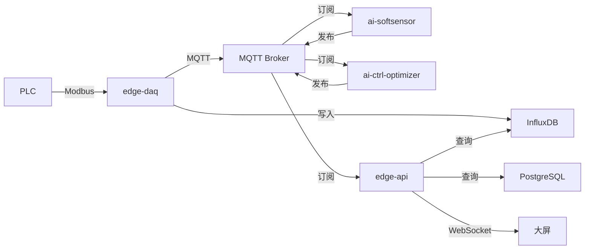

# 📘 工业烘干智能控制系统 - 边缘计算后端

<div align="center">

**企业级 · 工业级 · 可量产 · 长期维护**

[](LICENSE)
[](https://www.python.org/)
[](https://www.docker.com/)

</div>

---

## 📑 目录

- [项目介绍](#项目介绍)
- [系统架构](#系统架构)
- [核心特性](#核心特性)
- [技术栈](#技术栈)
- [快速开始](#快速开始)
- [服务说明](#服务说明)
- [API 文档](#api-文档)
- [配置说明](#配置说明)
- [部署指南](#部署指南)
- [开发指南](#开发指南)
- [测试](#测试)
- [OTA 升级](#ota-升级)
- [故障排查](#故障排查)
- [贡献指南](#贡献指南)
- [许可证](#许可证)

---

## 🎯 项目介绍

**工业烘干智能控制系统**是一套用于**双段烘干 + 发酵仓 + 尾气余热利用**的边缘计算智能控制解决方案。系统集成了 PLC 数据采集、AI 软测量、智能控制优化、授权管理、实时监控等功能，可在**完全离线环境**下 100% 运行。

### 应用场景

- 🏭 烟草行业烘干设备智能化改造
- 🌾 农产品烘干过程优化控制
- 🏗️ 工业物料干燥工艺优化
- 🔬 实验室级精密烘干控制

### 系统组成

| 模块 | 功能 | 技术 |
|------|------|------|
| **edge-api** | 统一 API 网关 | FastAPI + WebSocket |
| **edge-daq** | PLC 数据采集 | Modbus TCP + MQTT |
| **ai-softsensor** | 含水率软测量 | ONNX Runtime |
| **ai-ctrl-optimizer** | 控制参数优化 | PSO / 遗传算法 |
| **license-service** | 加密狗授权 | USB 硬件授权 |
| **edge-monitor** | 系统健康监控 | Docker + 系统指标 |

---

## 🏗 系统架构

### 三层架构

```
┌─────────────────────────────────────────────────────────────┐
│                        展示层                                 │
│  ┌──────────────┐  ┌──────────────┐  ┌──────────────┐      │
│  │ 数字孪生大屏  │  │   运维工具    │  │   移动端      │      │
│  └──────────────┘  └──────────────┘  └──────────────┘      │
└────────────────────────────┬────────────────────────────────┘
                             │ WebSocket / REST API
┌────────────────────────────┴────────────────────────────────┐
│                     边缘计算层 (本项目)                       │
│  ┌──────────┐  ┌──────────┐  ┌──────────┐  ┌──────────┐   │
│  │ Edge API │  │  AI 推理 │  │ 控制优化 │  │  授权服务 │   │
│  └──────────┘  └──────────┘  └──────────┘  └──────────┘   │
│  ┌──────────┐  ┌──────────┐  ┌──────────┐  ┌──────────┐   │
│  │  数据采集 │  │ 时序数据库│  │ 业务数据库│  │ MQTT Broker│   │
│  └──────────┘  └──────────┘  └──────────┘  └──────────┘   │
└────────────────────────────┬────────────────────────────────┘
                             │ Modbus TCP
┌────────────────────────────┴────────────────────────────────┐
│                        设备层                                 │
│  ┌──────────┐  ┌──────────┐  ┌──────────┐  ┌──────────┐   │
│  │   PLC    │  │  变频器   │  │  传感器   │  │  执行器   │   │
│  └──────────┘  └──────────┘  └──────────┘  └──────────┘   │
└─────────────────────────────────────────────────────────────┘
```

### 数据流向



---

## ✨ 核心特性

### 🚀 高性能

- ⚡ 数据采集频率：1Hz（可配置）
- 🎯 AI 推理延迟：< 500ms
- 📊 API 响应时间：< 200ms
- 💾 时序数据写入：5000 点/秒

### 🛡️ 高可靠

- 🔄 自动重连机制
- 💪 异常容错处理
- 📝 完整日志审计
- 🔐 加密狗授权保护

### 🔧 易维护

- 🐳 Docker 容器化部署
- 📦 一键 OTA 升级
- 🔍 健康检查监控
- 📊 Prometheus 指标

### 🌐 易扩展

- 🧩 模块化设计
- 📡 MQTT 消息总线
- 🔌 RESTful API
- 📝 完整配置管理

---

## 🧭 企业级现状评估（2025-12）

### ✅ 已具备
- `edge-api` 统一生命周期钩子：启动阶段自动建表、接入 MQTT / 事件总线 / WS 转发，配合 Structlog + 事件审计记录关键状态。
- `edge-monitor` 形成“策略 + 执行器 + 审计”的自愈闭环，可在 Docker 级别执行熔断重启并推送 MQTT 事件。
- 完整的 Docker Compose 拆分（API / 采集 / 推理 / 授权 / 监控 / DB / MQ），支持一键联调与模拟器。
- `/ready` 已实现真实依赖探测：并发检查 Postgres/Influx/MQTT/事件总线/WS 模块；不就绪返回 **HTTP 503**，可直接作为编排/监控判定依据（并已用于 Dockerfile `HEALTHCHECK`）。
- API 安全基线已落地：`edge-api` 统一采用 API Key（区分 control/admin）保护控制与运维接口；`edge-monitor` 的 `/ops/*` 高危接口也启用 API Key。
- 最小权限治理已推进：`edge-api` 不再挂载 `docker.sock`；容器重启/查询通过 `docker-socket-proxy` 收敛权限；容器日志由 `edge-api` 代理调用 `edge-monitor` 的受控日志端点。

### ⚠️ 待补齐
- 运维面限流与防滥用：对高危/高频接口（例如日志读取、运维动作）补齐速率限制与更细粒度审计（必要时落库）。
- 自动化测试进一步补齐：目前已有基础单测，但仍需扩展到“鉴权 + 异常 + 限流 + WS 推送 + 关键链路”的集成/契约测试，覆盖回归场景（模型加载、MQTT 序列、依赖抖动）。

> 📌 建议将上述事项收敛到安全基线、健康探活、CI 测试、最小权限治理四大里程碑，并在 `docs/architecture/` 与运行手册里同步记录。

---

## 🛠 技术栈

### 后端框架

- **FastAPI** - 现代化 Python Web 框架
- **Asyncio** - 异步 I/O 支持
- **SQLAlchemy** - ORM 数据库访问

### 数据存储

- **PostgreSQL** - 业务数据存储
- **InfluxDB** - 时序数据存储
- **Redis** - 缓存（可选）

### 消息通信

- **MQTT (Mosquitto)** - 消息队列
- **WebSocket** - 实时推送
- **Modbus TCP** - 工业协议

### AI & 机器学习

- **ONNX Runtime** - AI 模型推理
- **NumPy / Pandas** - 数据处理
- **Scikit-learn** - 机器学习

### 部署运维

- **Docker & Docker Compose** - 容器化
- **Nginx** - 反向代理（可选）
- **Prometheus** - 监控（可选）

---

## 🚀 快速开始

### 前置要求

确保已安装以下工具：

- Docker >= 20.10
- Docker Compose >= 2.0
- Git

### 1. 克隆项目

```bash
git clone <repository-url>
cd Drycontroller-edge
```

### 2. 配置环境

```bash
# 复制环境变量模板
cp env.example .env

# 根据实际情况修改配置
vim .env
```

### 3. 启动服务

```bash
# 使用开发脚本（推荐）
bash scripts/dev-start.sh

# 或直接使用 docker-compose
docker-compose up -d
```

> ✅ 默认 `.env` 配置齐全后，`docker-compose up -d` 将一次性拉起 edge-api、edge-daq、ai-softsensor、ai-ctrl-optimizer、license-service、edge-monitor、PostgreSQL、InfluxDB、Mosquitto 等全部服务。

### 4. 验证服务

```bash
# 检查服务状态
docker-compose ps

# 查看 API 文档
open http://localhost:8000/docs

# 查看日志
docker-compose logs -f edge-api
```

### 没有 PLC 也能联调

> 仍在对接 PLC 点位或现场不可用时，可运行内置模拟器生成实时曲线：

```bash
# 依赖 .env 中的 MQTT / InfluxDB 配置
python services/edge-daq/simulator.py
```

模拟器会每秒发布一整批温度、湿度、链速、抽风频率等典型点位到 MQTT，并写入 InfluxDB，便于大屏与后端立即看到连贯的实时/历史曲线。

### 5. 访问服务

| 服务 | 地址 | 说明 |
|------|------|------|
| API 文档 | http://localhost:8000/docs | Swagger UI |
| API 接口 | http://localhost:8000/api/v1 | RESTful API |
| InfluxDB | http://localhost:8086 | 时序数据库 |
| PostgreSQL | localhost:5432 | 业务数据库 |
| MQTT Broker | localhost:1883 | MQTT 服务 |

### 运维控制台（Svelte Ops Console）

如需查看统一的运维看板，可启动新建的 Svelte 前端：

```bash
cd ops-console
npm install
npm run dev
```

默认会代理到 `http://localhost:8000`。若要指向远程环境，可在 `ops-console/.env` 中设置：

```bash
VITE_API_BASE=http://edge-host:8000
VITE_WS_BASE=ws://edge-host:8000
```

控制台会展示系统状态、服务健康、自愈事件等信息，方便巡检与手动排查。

---

## 🧩 服务说明

### edge-api (端口: 8000)

**统一 API 网关**

提供以下功能：
- 📊 实时数据查询
- 📈 历史数据查询  
- 🎛️ 控制指令下发
- 🤖 AI 推理结果查询
- 🛠 运维接口（自愈开关、服务重启、monitor 配置管理）
- 🚨 报警管理
- ⚙️ 系统配置

**关键端点：**

```
GET  /api/v1/data/realtime       # 实时数据
GET  /api/v1/data/history        # 历史数据
GET  /api/realtime/latest        # Influx 最新点位
WS   /api/realtime/stream        # WebSocket 实时流
GET  /api/history                # 指定标签历史
POST /api/v1/control/set         # 控制指令
GET  /api/v1/ai/moisture/current # AI 含水率
GET  /api/v1/alarms/active       # 活动报警
GET  /api/v1/system/status       # 系统状态
```

### edge-daq (后台服务)

**PLC 数据采集**

功能：
- 🔌 Modbus TCP 通信
- 📡 MQTT 数据发布
- 💾 InfluxDB 写入
- 🚨 报警检测
- 🎭 PLC 模拟器（开发用）

**配置：** `configs/tags.yaml`

### ai-softsensor (后台服务)

**AI 软测量 - 含水率预测**

功能：
- 🧠 ONNX 模型推理
- 📊 多特征输入
- 🎯 置信度评估
- 📡 MQTT 结果发布

**模型位置：** `services/ai-softsensor/models/`  
（如目录不存在，请手动创建，并将训练好的 `.onnx` 模型文件放入其中；容器内挂载路径为 `/app/models`）

### ai-ctrl-optimizer (后台服务)

**智能控制优化**

功能：
- 🎯 目标含水率优化
- ⚡ 能耗最小化
- 🔒 约束条件检查
- 📊 多目标优化

**配置：** `configs/ai-config.yaml`

### license-service (端口: 8004)

**加密狗授权服务**

功能：
- 🔐 USB 加密狗验证
- ⏰ 授权过期检查
- 📝 授权日志记录

### edge-monitor (后台服务)

**系统监控服务**

功能：
- 💻 系统资源监控
- 🐳 Docker 容器监控
- 📊 指标采集上报
- 🚨 异常报警
- 🛡 自愈策略：依据 `configs/monitor.yaml` 中的阈值（`failure_threshold` / `recovery_observe` / `max_restart_per_hour`）自动重启异常容器并熔断防抖
- 🌐 HTTP 接口：`/health`、`/system/health`、`/system/metrics`
- 🔔 MQTT 状态：`system/<LINE>/status`
- 🔧 自愈模块位于 `services/edge-monitor/monitor/self_heal.py`，测试脚本见 `services/edge-monitor/tests/`

---

## 📚 API 文档

### 响应格式

所有 API 响应遵循统一格式：

```json
{
  "success": true,
  "data": { ... },
  "error": null,
  "timestamp": 1704067200
}
```

### 错误码

| 状态码 | 说明 |
|--------|------|
| 200 | 成功 |
| 400 | 请求参数错误 |
| 401 | 未授权 |
| 404 | 资源不存在 |
| 500 | 服务器错误 |

### 示例请求

```bash
# 获取实时数据
curl http://localhost:8000/api/v1/data/realtime

# 设置控制参数
curl -X POST http://localhost:8000/api/v1/control/set \
  -H "Content-Type: application/json" \
  -d '{
    "tag": "DRYER1.CHAIN.SPEED",
    "value": 4.5,
    "mode": "manual"
  }'

# 查询历史数据
curl "http://localhost:8000/api/v1/data/history?tag=DRYER1.OUT.TEMP&start_time=2025-01-01T00:00:00Z&end_time=2025-01-01T23:59:59Z"

# 获取最新点位（面向大屏）
curl "http://localhost:8000/api/realtime/latest?tags=DRYER1.IN.TEMP&lookback=10m"

# 查询历史曲线（自动聚合）
curl "http://localhost:8000/api/history?tag=DRYER1.IN.TEMP&period=6h&window=5m&aggregation=mean"
```

**WebSocket 推送：**

- `/api/ws/realtime?line=L1&tags=DRYER1.IN.TEMP`：订阅实时点位（默认全量）
- `/api/ws/ai?line=L1`：订阅 AI 软测量结果
- `/api/ws/system?line=L1`：订阅系统健康状态

可使用 `websocat` 或浏览器直接接收推送：

```bash
websocat ws://localhost:8000/api/ws/realtime
websocat ws://localhost:8000/api/ws/ai?line=L1
websocat ws://localhost:8000/api/ws/system
```

**详细 API 文档：** 启动服务后访问 http://localhost:8000/docs

---

## ⚙️ 配置说明

### 环境变量 (.env)

```bash
# 数据库
POSTGRES_HOST=postgres
POSTGRES_PORT=5432
POSTGRES_USER=edge_user
POSTGRES_PASSWORD=your_password

# InfluxDB
INFLUXDB_HOST=influxdb
INFLUXDB_TOKEN=your_token
INFLUXDB_ORG=edge-org
INFLUXDB_BUCKET=industrial-data

# MQTT
MQTT_BROKER=mosquitto
MQTT_PORT=1883
# MQTT（按服务拆分账号；配合 infra/mosquitto/acl 最小权限）
MQTT_USER_EDGE_API=edge_api
MQTT_PASSWORD_EDGE_API=your_password
MQTT_USER_EDGE_DAQ=edge_daq
MQTT_PASSWORD_EDGE_DAQ=your_password
MQTT_USER_AI_SOFTSENSOR=ai_softsensor
MQTT_PASSWORD_AI_SOFTSENSOR=your_password
MQTT_USER_EDGE_MONITOR=edge_monitor
MQTT_PASSWORD_EDGE_MONITOR=your_password

# PLC
PLC_HOST=192.168.1.100
PLC_PORT=502
USE_SIMULATOR=true  # 开发环境使用模拟器
```

### 标签配置 (configs/tags.yaml)

定义 PLC 标签映射：

```yaml
tags:
  dryer1:
    temperature:
      - name: DRYER1.IN.TEMP
        address: 40001
        type: float
        unit: "°C"
        range: [0, 200]
        alarm_high: 180
```

> 验证命名是否符合 `{EQUIPMENT}.{SECTION}.{METRIC}`：`python scripts/validate-tags.py`

### AI 配置 (configs/ai-config.yaml)

配置 AI 模型参数：

```yaml
softsensor:
  model_path: "/app/models/softsensor.onnx"
  input_features:
    - DRYER1.IN.TEMP
    - DRYER1.OUT.TEMP
    - DRYER1.CHAIN.SPEED
```

### 限制配置 (configs/limits.yaml)

定义工艺限制和报警规则：

```yaml
temperature_limits:
  dryer1:
    out_temp:
      max: 150
      alarm_high: 145
```

### 监控与自愈配置 (configs/monitor.yaml)

集中管理监控与自愈策略：

```yaml
services:
  interval: 20
  failure_threshold: 3     # 连续失败次数
  recovery_observe: 6      # 自愈后观察周期（单位：轮询周期）
  max_restart_per_hour: 5  # 每小时最大自动重启次数
  self_heal:
    enabled: true
  targets:
    - name: edge-api
      url: http://edge-api:8000/health
      container: edge-api
      self_heal:
        failure_threshold: 2   # 覆盖默认阈值
        max_restart_per_hour: 3
    - name: edge-mosquitto
      tcp:
        host: edge-mosquitto
        port: 1883
      self_heal:
        enabled: false         # 对 MQTT 仅做告警，不自动重启
```

> Monitor 服务会把上述阈值写入 `services/edge-monitor/monitor/main.py` 的 `service_health_state`，并在 MQTT `system/<LINE>/status` 报文中附带自愈状态。
>
> 可通过环境变量 `MQTT_TOPIC_SELF_HEAL`（默认 `events/system/self_heal`）指定自愈事件主题，订阅后可实时获知每次自动重启或熔断结果。

---

## 🚢 部署指南

### 开发环境部署

```bash
# 启动开发环境
bash scripts/dev-start.sh

# 查看日志
docker-compose logs -f

# 停止服务
docker-compose down
```

### 生产环境部署

```bash
# 1. 设置生产环境变量
cp env.example .env
vim .env  # 修改为生产配置

# 2. 构建生产镜像
bash scripts/build-images.sh v1.0.0

# 3. 启动生产服务
docker-compose up -d

# 4. 初始化数据库
bash scripts/init-db.sh

# 5. 验证服务
docker-compose ps
```

### 边缘设备部署

在工控机上部署：

```bash
# 1. 安装 Docker
curl -fsSL https://get.docker.com | sh

# 2. 上传项目文件
scp -r Drycontroller-edge/ user@edge-device:/opt/

# 3. SSH 登录设备
ssh user@edge-device

# 4. 启动服务
cd /opt/Drycontroller-edge
docker-compose up -d

# 5. 设置开机自启
sudo systemctl enable docker
```

### 相关文档

- 架构概览：`docs/architecture/system-overview.md`
- 部署细节：`docs/ops/deployment-guide.md`
- 大屏接入：`docs/architecture/big-screen-integration.md`
- 更多基础设施配置（MQTT/PostgreSQL/Prometheus/Alertmanager 等）：`infra/` 目录

---

## 👨‍💻 开发指南

### 代码规范

- Python 代码遵循 **PEP 8**
- 使用 **Black** 进行代码格式化
- 使用 **Ruff** 进行静态检查
- 所有函数必须有 **Docstring**

### 命名规范

| 类型 | 规范 | 示例 |
|------|------|------|
| 文件名 | snake_case | `data_processor.py` |
| 类名 | PascalCase | `DataProcessor` |
| 函数名 | snake_case | `process_data()` |
| 变量名 | snake_case | `current_temp` |
| 常量名 | UPPER_CASE | `MAX_RETRY` |

### Git 工作流

```bash
# 1. 创建功能分支
git checkout -b feature/new-feature

# 2. 开发并提交
git add .
git commit -m "feat: add new feature"

# 3. 推送分支
git push origin feature/new-feature

# 4. 创建 Pull Request
# 在 GitHub/GitLab 上创建 PR

# 5. 代码审查通过后合并到 develop
git checkout develop
git merge feature/new-feature
```

### 日志规范

使用结构化日志：

```python
import structlog

logger = structlog.get_logger(__name__)

logger.info(
    "data_received",
    tag="DRYER1.OUT.TEMP",
    value=85.2,
    unit="°C"
)
```

---

## 🧪 测试

### 运行测试

```bash
# 运行所有测试
pytest

# 运行特定服务测试
pytest services/edge-api/tests/

# 生成覆盖率报告
pytest --cov=services --cov-report=html
```

### 创建测试虚拟环境

macOS 默认开启 PEP 668 保护，建议在仓库根目录创建虚拟环境安装依赖：

```bash
python3 -m venv .venv
source .venv/bin/activate
pip install -r services/edge-monitor/requirements.txt pytest
```

### 示例：运行 edge-monitor 自愈测试

```bash
source .venv/bin/activate
python -m pytest services/edge-monitor/tests
```

### 测试类型

- ✅ 单元测试
- ✅ 集成测试
- ✅ API 接口测试
- ✅ PLC 模拟测试

各服务已在 `services/<service>/tests/` 下预留测试目录，建议在此基础上逐步补充更多单元测试与集成测试用例。

---

## 🔄 OTA 升级

### 在线升级

```bash
# 拉取最新镜像并重启
bash scripts/ota-update.sh online
```

### 离线升级

```bash
# 使用 OTA 升级包
bash scripts/ota-update.sh offline /path/to/ota-package.tar.gz
```

### 回滚

```bash
# 回滚到上一个版本
bash scripts/ota-update.sh rollback
```

---

## 🔍 故障排查

### 常见问题

#### 1. 服务无法启动

```bash
# 检查 Docker 状态
docker ps -a

# 查看服务日志
docker-compose logs edge-api

# 重启服务
docker-compose restart edge-api
```

#### 2. 无法连接 PLC

```bash
# 检查网络连通性
ping <PLC_IP>

# 测试 Modbus 连接
docker-compose exec edge-daq python -c "from daq.modbus_client import ModbusClient; import asyncio; asyncio.run(ModbusClient('192.168.1.100', 502).connect())"

# 使用模拟器
# 在 .env 中设置 USE_SIMULATOR=true
```

**现场快速定位（推荐）：先看 /ready 的 reason/hint**

- **edge-daq**：`/ready` 会在 PLC/Modbus 不通时返回 `reason=PLC_OFFLINE`，并给出可操作的 `hint`（例如：不要把 `PLC_HOST` 配成 `127.0.0.1/localhost`，因为在容器内这是“指向容器自身”，必然连不上现场 PLC）。
- **ai-softsensor**：当它依赖的数据链路未就绪时会返回 `reason=DQ_NOT_READY`，并提示通常与 `edge-daq`（PLC 离线导致无数据）相关；避免把“上游没数据”误判成“软测量服务崩溃”。

> 如果你使用云端 `cloud-console`，节点详情页也会直接显示“PLC 不在线/Modbus 不通”的告警条（来自 edge-monitor 汇总的 warnings）。

#### 3. 数据库连接失败

```bash
# 检查 PostgreSQL
docker-compose exec postgres pg_isready

# 检查 InfluxDB
curl http://localhost:8086/health
```

### 日志位置

```
logs/
├── edge-api/
├── edge-daq/
├── ai-softsensor/
├── ai-ctrl-optimizer/
├── license-service/
└── edge-monitor/
```

---

## 🤝 贡献指南

我们欢迎任何形式的贡献！

### 如何贡献

1. Fork 本项目
2. 创建功能分支 (`git checkout -b feature/AmazingFeature`)
3. 提交更改 (`git commit -m 'Add some AmazingFeature'`)
4. 推送到分支 (`git push origin feature/AmazingFeature`)
5. 创建 Pull Request

### 代码审查

- 所有 PR 必须通过 CI 测试
- 至少需要 1 人审查通过
- 代码覆盖率不低于 80%

---

## 📄 许可证

本项目采用 MIT 许可证 - 详见 [LICENSE](LICENSE) 文件

---

## 📞 联系方式

- 📧 Email: support@example.com
- 🌐 Website: https://example.com
- 💬 Issues: [GitHub Issues](https://github.com/username/repo/issues)

---

## 🙏 致谢

感谢所有贡献者对本项目的支持！

---

<div align="center">

**Made with ❤️ for Industrial IoT**

</div>
