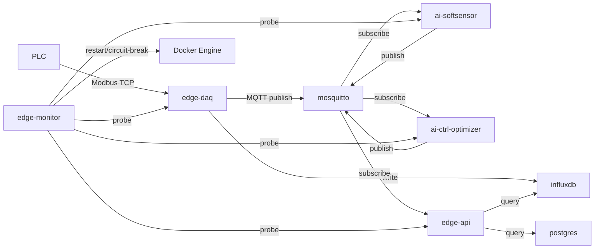

# 📘 系统架构总览（System Overview - Edge）

> **范围**：本仓库 `Drycontroller-edge`（单台边缘机离线 7x24 运行）  
> **对齐原则**：本文档以当前代码与编排为准；对“规划/未实现”会明确标注。  
> **更新时间**：2025-12-26

---

## 0. 工业现场 7x24（离线）验收口径

### 0.1 目标

- **离线**：不依赖外部云端；边缘侧本地数据库与 MQTT 完整闭环可运行。
- **7x24**：可长期运行、可自恢复、可观测、可运维；发生故障能定位、能恢复、能追溯。
- **不影响生产底座**：边缘系统故障时，**PLC 侧仍应具备最小安全联锁/稳态运行能力**（边缘不作为最后安全屏障）。

### 0.2 系统边界（明确不做/不承诺）

- **安全联锁**：超温/硬件安全联锁在 PLC/硬件侧完成；边缘侧只做监测、告警、建议与受控下发。
- **多机高可用**：本目标为单机；不讨论双机热备/集群。
- **云端统一管控**：云端运维与资产管理不在本仓库范围（`Drycontroller-cloudserver` 另算）。

---

## 1. 架构概览

### 1.1 核心组件（Docker Compose）

边缘侧采用容器化组合部署（见 `docker-compose.yml`）：

- **`edge-api`**：统一 REST/WebSocket API，聚合实时/历史/系统状态；对控制与运维接口提供 API Key 鉴权能力。
- **`edge-daq`**：PLC（Modbus TCP）采集与数据发布；写入 InfluxDB；订阅控制指令并回执 ACK（闭环）。
- **`ai-softsensor`**：订阅 MQTT 实时点位进行 ONNX 推理（软测量），发布结果到 MQTT/Influx。
- **`ai-ctrl-optimizer`**：订阅数据并输出控制建议（策略/优化），通过 API 对外提供建议。
- **`license-service`**：授权校验（USB 加密狗相关）。
- **`edge-monitor`**：系统指标采集、服务探活、自动自愈（容器重启/熔断）、告警聚合（Alertmanager）。
- **`mosquitto`**：本地 MQTT Broker（默认禁匿名，口令文件）。
- **`influxdb`**：本地时序库（实时/历史曲线、事件记录）。
- **`postgres`**：业务/配置库（模型/报警/业务表等）。
- **`prometheus` + `alertmanager`**：指标采集与告警聚合（ops-console 可读）。

### 1.2 数据流（离线闭环）

---

## 2. 可用性与健康检查（以编排/监控可判定为目标）

### 2.1 `edge-api` 探活端点

- **`GET /health`**：进程存活（liveness）
- **`GET /ready`**：依赖就绪（readiness），并发探测：
  - PostgreSQL（`SELECT 1`）
  - InfluxDB（`/health`）
  - MQTT（客户端是否已连接）
  - 事件总线与 WS 转发模块是否已启动  

当任一关键依赖不健康时返回 **HTTP 503**，便于 `edge-monitor`/编排正确判定“不可用”。

### 2.2 `edge-monitor` 探活与状态输出

`edge-monitor` 周期性输出：

- 系统指标（CPU/内存/磁盘/uptime）
- 服务探活（HTTP/TCP/容器状态，取最严重状态）
- 自愈状态（连续失败计数、阈值、冷却、每小时重启计数等）

并通过 MQTT 主题 `system/<LINE>/status` 发布运行态快照。

---

## 3. 自维护与自愈（当前实现对齐）

### 3.1 已实现：服务级自动自愈（容器重启 + 熔断冷却 + 审计事件）

`edge-monitor` 的服务探活循环会在每轮检查后执行自愈决策：

- **阈值触发**：连续失败达到 `failure_threshold` 才会尝试重启
- **冷却窗口**：重启成功后进入观察冷却（`recovery_observe * interval`）
- **熔断**：超过 `max_restart_per_hour` 则升级为 `escalate` 并进入更长冷却，避免重启风暴
- **审计上报**：自愈动作会写日志并发布 MQTT 事件（默认 `events/system/self_heal`）

配置入口：`configs/monitor.yaml`（全局默认 + target 覆盖）。

### 3.2 未实现/需谨慎承诺

- **AI 模型版本登记与自动回滚**：当前未形成“多版本登记 + 校验 + 回退”的完整闭环。
- **OTA 蓝绿发布/自动回滚**：当前脚本以 compose pull/up 为主，未实现蓝绿与自动判定回滚。
- **数据级补偿（Influx 不可用时缓存补写）**：当前未形成统一的本地缓存补写机制。

---

## 4. 安全与最小权限（离线 7x24 的硬门槛）

### 4.1 现状

- `edge-api` 的控制/运维接口已支持 API Key 鉴权（未配置 key 时会拒绝访问）。
- `mosquitto` 禁止匿名连接，使用口令文件。
- `edge-monitor` 需要访问 Docker 引擎以实现自动重启（当前默认通过受控 `docker-socket-proxy` 访问 Docker API；宿主机的 `docker.sock` 不再直接暴露给业务容器）。

### 4.2 需要重点加固（建议作为 7x24 验收前置）

- **运维高危接口必须鉴权**：包括重启容器、自愈开关、读取日志、告警查询等。
- **docker.sock 风险隔离**：若必须使用，建议采用受控代理（socket-proxy）或把运维接口锁定在本机/内网管理平面。
- **网络暴露面最小化**：默认仅暴露 `edge-api` 必要端口；监控与运维端口按需开启且受控。

---

## 5. 可观测性（日志/指标/事件）

- **日志**：结构化 JSON（structlog），落盘到 `./logs/<service>/app.log` 并输出 stdout。
- **指标**：`edge-api` 提供 `/metrics`；Prometheus/Alertmanager 组合用于告警与聚合查询。
- **事件**：关键动作（启动/停止/异常/自愈）可写入 InfluxDB measurement（见 `docs/ops/logging-standard.md`）。

---

## 6. 与 7x24 相关的“最小运行手册”入口

- 部署与开机自启：`docs/ops/deployment-guide.md`
- 日志规范与轮转：`docs/ops/logging-standard.md`
- 风险评估：`docs/architecture/risk-assessment.md`
- 自愈规范（对齐实现）：`docs/architecture/self-healing.md`

